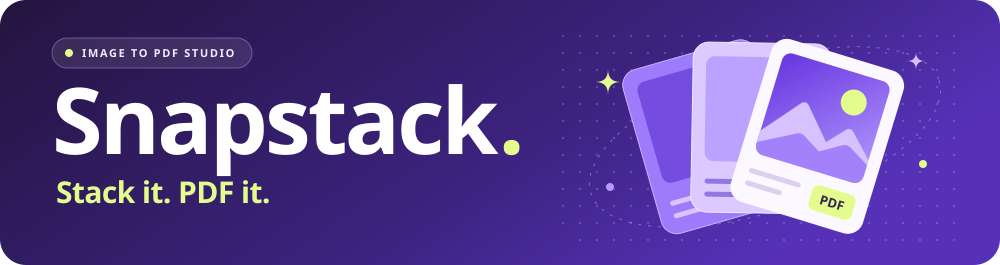

<h1 align="center">
  
</h1>

<strong>Turn a pile of images into one PDF, in the order you choose.</strong>

  <a href="https://rorrimaesu.github.io/snapstack-pdf/"><strong>⚡ Open Snapstack on GitHub Pages →</strong></a>

🖼️ One image per page &nbsp;·&nbsp; 🗂️ Drag to reorder &nbsp;·&nbsp; 🔒 Images stay on your device

## From images to PDF in three steps

| Step | What to do |
| --- | --- |
| **01 · Add images** | Drop your files into **Image stack** or click **Browse files**. |
| **02 · Set the order** | Drag the thumbnails into place or use the up and down arrows. |
| **03 · Create your PDF** | Enter a file name, choose a save option, and click **Create PDF**. |

Hover over a thumbnail for a full-resolution preview that fits the screen. Click or tap the thumbnail to keep the preview open.

## Choose where it goes

On desktop Chrome or Edge, select **Ask where to save** to open a Save As dialog and pick a folder. In other browsers, **Browser downloads** uses your download settings. Turn on your browser’s download prompt to pick a folder each time.

## Image formats and output

**JPG · PNG · WebP · GIF · BMP · AVIF**, depending on what your browser can decode.

Each page follows its image’s aspect ratio. Animated images use their first frame, transparent areas appear white, and export resolution is capped at 3,200 pixels on the longest side.

## Run it locally

Open `index.html` in your browser. GitHub Pages serves the same static files from the repository root.
